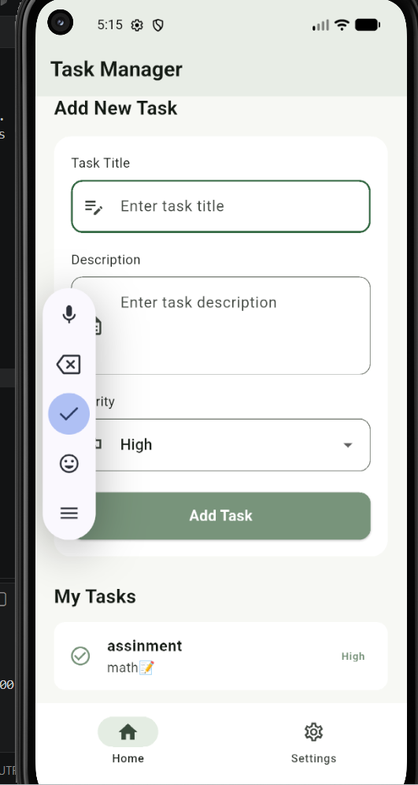

# task5
## Task Manager
A simple Flutter application designed to help users organize and manage their daily tasks.

Users can add tasks by entering a title, description, and priority level. The app includes input validation to ensure all required fields are completed before submission.

## Features
Add new tasks.
Set task priority (Low, Medium, High).
Validate user inputs.
View added tasks.
Simple Home and Settings navigation.
## Technologies
Flutter

Dart
## Screenshots

### Home Page
 

#### Form Validation
 

